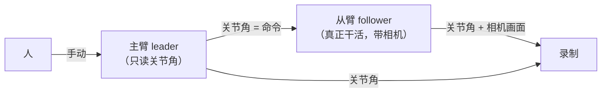
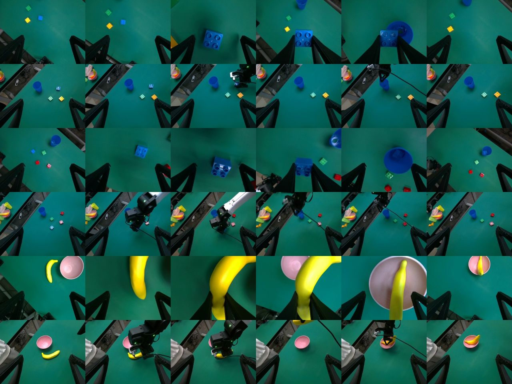
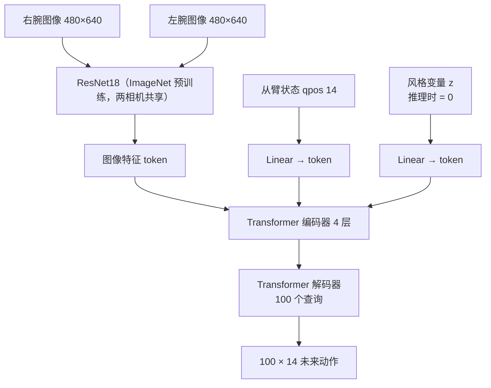

# 01 背景知识

读懂本仓库需要的概念。仓库的结构与用法见 [02_repo.md](02_repo.md)。

## 机器人与数据

### 主从遥操作

| 概念 | 含义 | 在本项目中 |
|---|---|---|
| 主臂 leader | 人手里拿着摆动的那只臂 | 它的关节角 = **动作（训练标签）** |
| 从臂 follower | 跟随主臂运动、碰到物体的那只臂 | 它的关节角 = **状态（网络输入 qpos）** |
| 为什么动作用主臂 | ① 从臂约晚 130 ms（4 帧）才到位；② 夹住物体时主臂夹爪合到 0.15，从臂被物体挡在 0.20 | 学从臂的话，模型永远学不会「用力夹」 |
| 模仿学习 / 行为克隆（BC） | 给定「看到什么」，模仿「人当时怎么做」 | 只用示范数据，没有奖励、没有仿真 |
| 示范 episode | 一次完整的任务录制 | 每个任务约 50–100 条 |

### 14 维向量（全项目统一）

| 下标 | 0–5 | 6 | 7–12 | 13 |
|---|---|---|---|---|
| 含义 | 左臂 6 个关节（rad） | 左夹爪 0 闭 – 1 开 | 右臂 6 个关节（rad） | 右夹爪 |

状态 qpos、动作 action 都是这个布局。

### 录制数据（NEDF3 / MCAP）

| 项 | 内容 |
|---|---|
| 格式 | 采集项目 SuperInference 录的 MCAP 文件（protobuf 消息，schema 内嵌） |
| 相机 | 两个腕部 RealSense D405，30 fps，480×640；`head` 相机是黑屏占位，不用 |
| 左腕相机 | 单臂任务里左臂几乎不动 → 实际上是一个**俯视整张桌子的固定视角** |
| 时间对齐 | 关节和相机各自有时间戳，转换时统一重采样到 30 Hz：关节线性插值，相机取最近一帧 |

> 每两行是一条示范：上一行右腕相机，下一行左腕相机。

### 任务

| 任务 | 条数 | 用臂 | 内容 |
|---|---|---|---|
| `put_block_in_bowl` | 49 | 右 | 积木在左、碗在右，把积木放进碗 |
| `put_blue_block_in_blue_cup` | 100 | 右 | 1–6 个彩色积木，把唯一的蓝积木放进蓝杯（颜色是关键 → 数据增强不能改色相） |
| `fold_towel` | 51 | **双** | 叠毛巾，两个夹爪都用 |
| `unroll_cylinder` | 50 | **双** | 双手托住圆筒，右手夹住盖子拔下 |

单臂任务推理时冻结左臂（`freeze_left`）；双臂任务不能冻结。

## ACT（Action Chunking with Transformers）

ALOHA 论文（Zhao et al. 2023）提出，专为「双臂主从遥操作 + 约 50 条示范」设计，和 YAM 形态一样。本仓库**完全按源码 `tonyzhaozh/act`** 训练。

| 概念 | 含义 | 为什么 |
|---|---|---|
| 动作分块 chunk | 一次预测未来 100 步（30 Hz → 3.3 s） | 每次只预测 1 步，小误差会逐步累积；一次规划一段，动作连贯，对人的停顿不敏感 |
| 时间集成 temporal ensembling | 每一帧都预测一次 → 同一时刻被多个 chunk 覆盖 → 加权平均，权重 `exp(-k·i)`，k=0.01，i=0 是**最旧**的预测 | 动作更平滑 |
| CVAE / 风格变量 z | 训练时一个编码器把真实动作压成 z（32 维），告诉网络「这次是哪种做法」；推理时 z=0 | 人每次做法不同，z 吸收这种差异 |
| 损失 | L1（预测 vs 真实动作）+ 10 × KL（让 z 别乱跑） | 源码 `kl_weight=10` |
| 归一化 | 状态、动作按均值 / 标准差缩放 | 各关节量纲一致 |
| 解码器 7 层只用第 1 层 | 源码的写法如此（取中间输出的 `[0]`） | 照搬，不改 |

### 动作表示：abs vs delta

| 模式 | 第 k 步的标签（观测在时刻 t） | 特点 |
|---|---|---|
| `abs` | 主臂(t+k) | 源码做法；网络要「记住」绝对位置 |
| `delta` | 主臂(t+k) − 从臂(t) | 只学「接下来怎么动」，与当前位置无关；机器人上再加回 从臂(t)。所有步都相对同一个 chunk 起点，执行时不会累计误差 |

### action_shift

chunk 第 0 步 = 主臂(t − `action_shift`)。源码真机数据用 1（修 ALOHA 录制的对齐问题）；我们的录制按时间戳对齐（腕部图像和从臂关节是同一帧），所以用 **0**。两者差别只有 0.002–0.003 rad。

### epoch 与训练时长

| 项 | 含义 |
|---|---|
| 源码的 1 个 epoch | 每条训练示范随机抽 **1 个**时刻 → 40 条示范只有 5 个 batch（batch 8） |
| 为什么 20000 epoch | 源码默认 5000 epoch 只有约 2.5 万次参数更新。ACT README：「策略卡顿或中途停顿，就多训；成功率在 loss 平台后还会涨」 |
| 80/20 与 `_all` | 80/20 划分的运行用来比较、选 epoch；`train_ratio=1.0` 用全部示范的运行用来交付。同一 epoch 数下两者训练程度相当 |

## 怎么判断模型好不好

| 方法 | 含义 | 局限 |
|---|---|---|
| 验证 loss | 没见过的示范上的损失 | ACT 源码每 epoch 只有约 10 个样本，而且用编码器给的 z（不是推理时的 z=0）→ `best.pt` 基本是噪声，**不用来选模型** |
| 开环评估 open-loop | 在录制的验证示范上，每帧喂真实画面，比较预测和人的动作（`eval_offline`） | 只说明「看着示范画面能否复现人」；闭环中误差会累积 |
| 抓取测试 | 第一次合夹爪前 0.5 / 1 / 2 s 的画面 → 模型计划在合夹爪时到达的右臂姿态 vs 人的实际姿态；误差 < 0.04 rad（约 1.5 cm）算「对准」 | 只看抓取那一刻 |
| 闭环 / 真机 | 模型实际控制机器人 | 唯一可靠的标准；最后在真机上比较 1–2 个候选 |
| 过拟合 | train 误差持续降、val 不降反升 | 行为克隆中 train/val 有差距很常见，val 持平不代表真机变差 |

单位参考：0.02 rad ≈ 1.1°；关节误差 0.04 rad 在末端约 1.5 cm。

## pi0.5（openpi）

Physical Intelligence 开源的 VLA（vision-language-action）模型，在 1 万多小时的多种机器人数据上预训练过。我们从 `pi05_base` 继续做全参数微调。

| 概念 | 含义 |
|---|---|
| VLA | 视觉 + 语言 + 动作：图像和一句英文指令一起输入，输出动作。**一个模型多个任务**，用指令区分 |
| 网络 | PaliGemma（SigLIP 视觉编码器 + Gemma 2B 语言模型）+ 动作专家，共 3.3B 参数 |
| flow matching | 训练：把真实动作块和随机噪声按比例混合，让网络预测「从噪声指向真实动作的方向」，损失是它的均方误差。推理：从噪声出发迭代 10 步得到动作块。损失值小不代表动作准，选模型看开环评估 |
| 动作块 | 50 步（1.67 s） |
| 图像 | 等比缩放到 224×168，上下补黑边成 224×224（`resize_with_pad`） |
| 3 个图像位置 | `base_0_rgb`（全景）← 左腕相机；`right_wrist_0_rgb` ← 右腕相机；`left_wrist_0_rgb` 填黑图，mask=False |
| 分位数归一化 | 每维把 1% 分位数映射到 −1、99% 分位数映射到 +1（不是均值 / 标准差）。统计量 `norm_stats.json` 随模型保存 |
| delta 掩码 | 哪些维度做 delta（相对当前从臂状态）。单臂任务：只有右臂关节（左臂不动，delta 的分位区间约 ±0.001，会把偶尔的真实动作放大 100–300 倍）；双臂任务：两臂关节。夹爪都是绝对值 |
| 状态 token | 状态还会被离散成 256 档，作为文字放进 prompt |
| EMA | 参数的指数滑动平均（0.99），保存的是 EMA 权重，更稳 |
| FSDP | 把模型参数切开分到多张卡（我们 2 卡一组），一张卡放不下时用 |
| LeRobot 数据集 | openpi 读的训练数据格式（parquet + 图像），由 `to_lerobot` 转出 |
| JAX / XLA | openpi 用的框架；`XLA_PYTHON_CLIENT_MEM_FRACTION` 控制 JAX 预占多少显存 |
| 策略服务 | 推理单独起一个进程（openpi 环境、GPU），yam_infer 通过 websocket 发观测、收动作。每次推理约 100 ms，所以用「执行 25 步再重新规划」的 chunk 模式，不每帧推理 |

### ACT 与 pi0.5 对照

| | ACT | pi0.5 |
|---|---|---|
| 规模 | 84M，ResNet18 之外从零训练 | 3.3B，从大规模预训练继续 |
| 任务 | 一个任务一个模型 | 一个模型多个任务 |
| 动作生成 | 一次前向 | 10 步去噪 |
| chunk | 100 步 | 50 步 |
| 图像 | 480×640 原图 | 224×224 |
| 框架 / 环境 | PyTorch，本仓库 `.venv` | JAX，`../openpi/.venv` |
| 推理位置 | yam_infer 进程内 | 单独的策略服务 |
