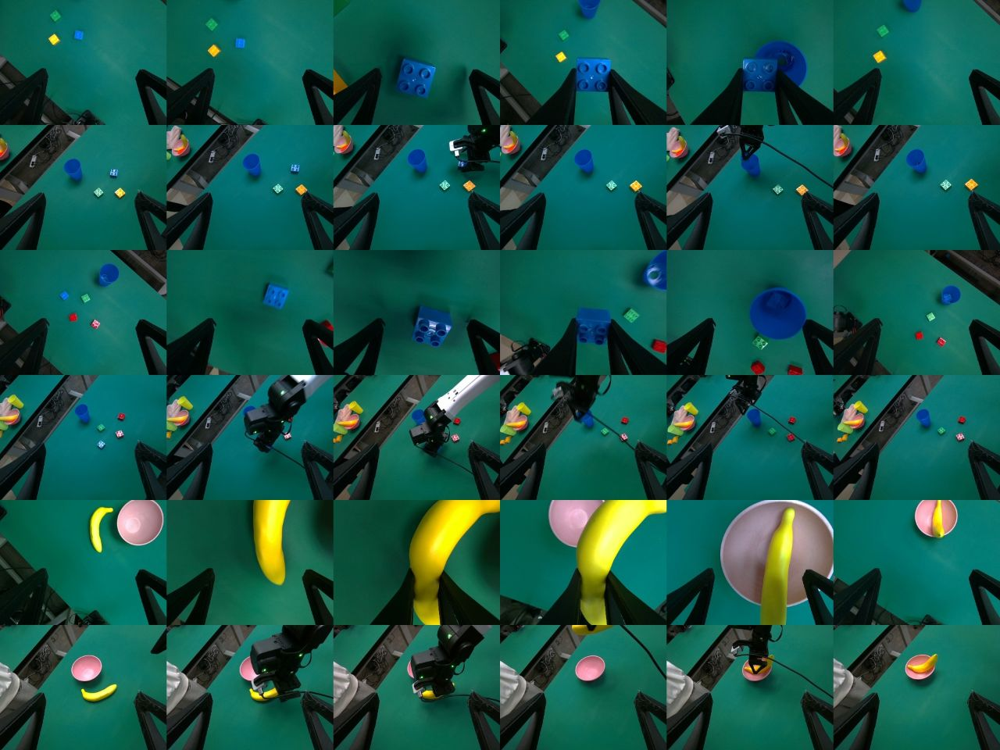
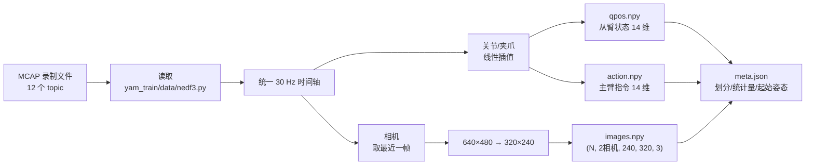
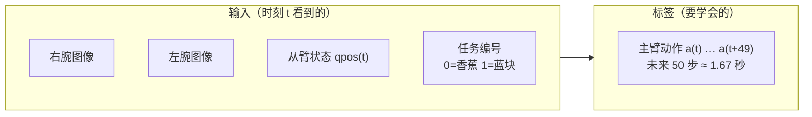

# 01 数据：从录制文件到训练样本

## 我在数据里发现了什么

| 发现 | 数值 | 对设计的影响 |
|---|---|---|
| 示范数量 | 香蕉 31 条 + 蓝块 50 条 = 81 条，共 24 分钟 | 数据少 → 选「小而稳」的模型 ACT，并做数据增强 |
| 谁在干活 | **只有右臂**在动（运动范围 0.7–2.5 rad），左臂基本不动（< 0.3 rad） | 左腕相机实际上是一个「俯视全局相机」，能看到桌面和右臂 |
| 主从延迟 | 从臂比主臂慢 **约 130 ms**（夹爪约 60 ms） | 动作 = **主臂**（人的意图），而不是从臂（滞后的结果） |
| 相机 | 两个腕部 D405，30 fps，640×480；head 是黑图 | 只用两个真相机，丢掉黑图 |
| 起始姿态 | 每条起点不同（标准差 0.1–0.3 rad） | 推理开始前先移动到「平均起始姿态」 |
| 颜色 | 蓝块任务靠颜色区分（蓝/绿/黄/红） | 数据增强**不改色相**，否则模型分不清蓝色 |

> 每两行是一条示范：上一行右腕相机，下一行左腕相机（全局视角）。

## 转换流程

命令：`python -m yam_train.data.convert --raw RAW --out DATA`（服务器上 40 进程，约 1 分钟）

## 14 维向量（全项目统一）

| 下标 | 0–5 | 6 | 7–12 | 13 |
|---|---|---|---|---|
| 含义 | 左臂 6 个关节（rad） | 左夹爪 0 闭–1 开 | 右臂 6 个关节（rad） | 右夹爪 |

## 一个训练样本 = 一个时刻

| 项 | 数值 |
|---|---|
| 总样本（时刻） | 42,859 |
| 训练集 | 73 条示范，38,937 个样本 |
| 验证集 | 每个任务每 10 条取 1 条 → **8 条**，3,922 个样本（模型从没见过，用来检查过拟合） |
| 数据集大小 | 19.7 GB（服务器 `~/output/yam_train/data_v1`，训练时复制到内存盘 `/dev/shm`） |
