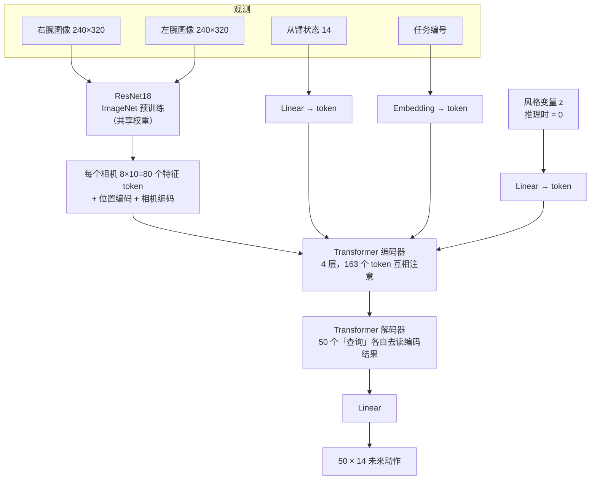
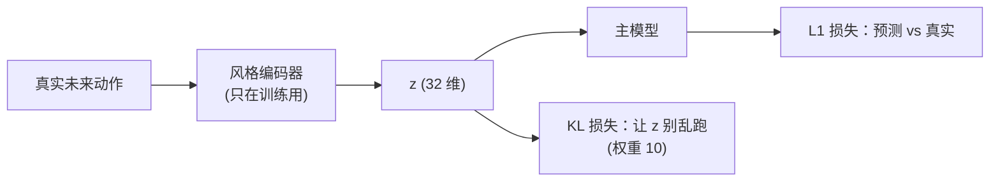
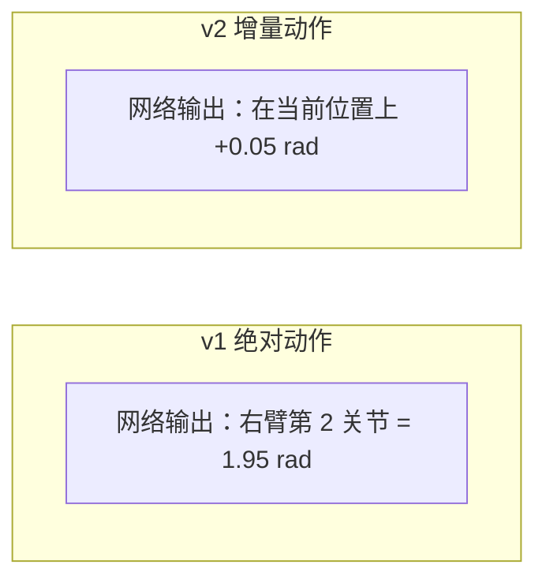

# 02 模型：ACT（Action Chunking with Transformers）

## 为什么选 ACT

| 候选                | 优点                                                                                             | 缺点                                           | 结论    |
| ------------------- | ------------------------------------------------------------------------------------------------ | ---------------------------------------------- | ------- |
| **ACT**             | 专为「主从臂遥操作 + 约 50 条示范」设计（ALOHA 双臂，和 YAM 形态一样）；一次前向就出动作，速度快 | 只能学「平均」的风格                           | ✅ 选用 |
| Diffusion Policy    | 能表达多种做法                                                                                   | 推理需要多步去噪，速度慢；更难调               | 备选    |
| VLA 大模型（π0 等） | 有语言理解，泛化强                                                                               | 机器人端需要大显卡；数据只有 24 分钟，收益有限 | 不选    |

## 整体结构

## 三个核心概念

### 1. 动作分块（Action Chunking）

| 每次只预测 1 步           | 每次预测 50 步（ACT）              |
| ------------------------- | ---------------------------------- |
| 小误差逐步累积 → 越走越偏 | 动作连贯，相当于「一口气规划一段」 |
| 人类停顿会让模型犹豫      | 对停顿和抖动不敏感                 |

### 2. 时间集成（Temporal Ensembling）

每 33 ms 预测一次，所以同一个未来时刻会被多次预测 → 取加权平均，动作更平滑。

```mermaid
gantt
    dateFormat X
    axisFormat %s
    section 预测 t=0
    覆盖 0~49 :0, 50
    section 预测 t=1
    覆盖 1~50 :1, 51
    section 预测 t=2
    覆盖 2~51 :2, 52
    section 实际执行
    第 2 步 = 三次预测的平均 :crit, 2, 3
```

### 3. CVAE（风格变量 z）

人每次做同一件事，快慢和路线都不一样。训练时由一个「风格编码器」把真实动作压缩成 z，告诉模型「这次是哪种风格」；**推理时 z=0 = 最常见的风格**。

## 参数表

| 项                           | 值                                           | 说明                                      |
| ---------------------------- | -------------------------------------------- | ----------------------------------------- |
| 参数量                       | 51.6 M                                       | ResNet18 约 11M，其余是 Transformer       |
| 图像                         | 2 × 240×320                                  | 原图 640×480 缩小一半                     |
| chunk                        | 50 步 / 1.67 s                               | 30 Hz                                     |
| d_model / heads              | 512 / 8                                      | Transformer 宽度                          |
| 编码器 / 解码器 / 风格编码器 | 4 / 1 / 4 层                                 | 与原论文实际生效的层数一致                |
| 动作                         | 主臂 14 维，**相对当前从臂状态的增量**（v2） | `a(t+k) − qpos(t)`，再按均值/标准差归一化 |

## 绝对动作 vs 增量动作（v1 → v2 的关键改进）

|                            | v1 绝对                                                         | v2 增量                       |
| -------------------------- | --------------------------------------------------------------- | ----------------------------- |
| 不动的左臂                 | 要「背出」当前角度，偏差 0.03 rad → 左臂乱动 → 全局相机视角变了 | 输出 ≈ 0 就行，偏差 0.007 rad |
| 不同起始姿态               | 要记住绝对位置                                                  | 只学「怎么动」，更好泛化      |
| 下一步误差（右臂，验证集） | 0.042 rad                                                       | **0.020 rad**                 |

代码：`yam_train/model/act.py`
