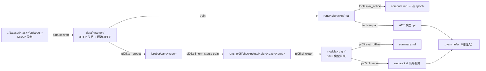
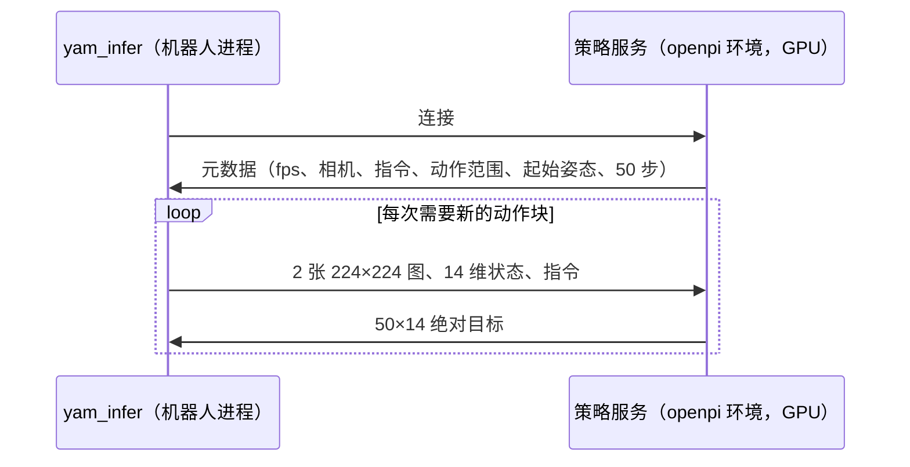

# 02 仓库结构与用法

概念见 [01_background.md](01_background.md)。

## 数据流



## 目录

```text
yam_train/
├── AGENTS.md / SEVERS.md      代理说明 / 三台机器
├── configs/
│   ├── act_ref.yaml           ACT 源码的全部默认值（数据 / 网络 / 训练）
│   ├── long.yaml              ← act_ref，只改训练长度：20000 epoch，每 2000 存 ckpt
│   ├── <任务>_{abs,delta}.yaml ← long，只设 data.task 和 data.action_mode（8 个）
│   └── pi05/val_episodes*.json  pi0.5 split 运行留出的验证示范（= ACT 80/20 的验证集）
├── yam_train/
│   ├── config.py              YAML 读取：_base_ 继承、--set a.b=c 覆盖
│   ├── data/
│   │   ├── nedf3.py           读一条 MCAP 录制；14 维布局
│   │   ├── convert.py         录制 → 30 Hz 数据目录
│   │   └── dataset.py         = 源码 utils.py（FrameStore、EpisodicDataset、归一化、划分）+ delta
│   ├── detr/                  从 tonyzhaozh/act 拷贝的网络（不改，见 VENDORED.md）
│   ├── policy.py              = 源码 ACTPolicy + 建优化器
│   ├── train.py               = 源码 train_bc；单卡、一个任务一个模型
│   ├── tools/
│   │   ├── eval_offline.py    多个 ACT ckpt 一起做开环评估（z=0、时间集成）
│   │   └── export.py          去掉优化器状态 → 交付 .pt
│   └── pi05/                  只在 openpi 环境里运行
│       ├── yam_policy.py      机器人数据 ↔ 模型输入（相机位置、PROMPTS、DELTA_MASK*）；训练和服务共用
│       ├── config.py          openpi TrainConfig（CONFIGS 表），注册进 openpi
│       ├── to_lerobot.py      数据目录 → LeRobot 数据集
│       ├── cli.py             norm-stats / train / export / serve
│       └── eval_offline.py    开环评估：抓取测试 + 动作块误差
├── scripts/
│   ├── setup_venv.sh          建 .venv（torch 2.7.1+cu126；参数 cpu 给无 GPU 机器）
│   ├── train_all.sh           后台启动多个 ACT 训练
│   ├── setup_openpi.sh        装 openpi（215abfb）+ uv 环境 + 下载 pi05_base
│   ├── pi05_env.sh            source 后得到 $PI05_PY 等环境变量
│   ├── train_pi05.sh          两个 pi0.5 训练（split + all），各 2 卡
│   └── pi05_after_act.sh      无人值守：等数据 → norm-stats → 等 ACT 结束 → 启动 pi0.5
└── docs/
```

不进 git：`.venv/`、`data/`、`runs/`、`models/*.pt`、`tmp/`（本机放 openpi 源码 `tmp/openpi` 供 pyright 检查）。

## 转换后的数据目录（`data.convert`）

| 文件 | 内容 |
|---|---|
| `meta.json` | fps、相机、图像尺寸、任务、每条 episode 的名称 / 任务 / 起始行 / 长度（`format: yam_train/jpeg-v1`） |
| `qpos.npy` | float32 (N, 14)，从臂状态 |
| `action.npy` | float32 (N, 14)，主臂（人的命令） |
| `<camera>.jpg.bin` / `.idx.npy` | 录制时的 JPEG 原字节（480×640，不缩放不重编码）+ 每行的 (偏移, 长度) |

- 读 `<task>/episode_*`，也读 `<task>/<子目录>/episode_*`（任务名取最上层目录）。
- 没有 `data/mcap_index.json` 的 episode（录制未完成）跳过。

| 目录 | 内容 | 用于 |
|---|---|---|
| `data/nedf3_30hz` | `convert --raw ../dataset` | ACT（`act_ref.yaml` 默认 `data.root`） |
| `data/nedf3_30hz_v3` | 积木放碗 + 蓝块放蓝杯 50 条 + `blue_block_v2` 12 条 | `pi05_yam` |
| `data/nedf3_30hz_r3` | 蓝杯 100 条 + 叠毛巾 + 拔盖子 | `pi05_yam3` |

## ACT

### 配置

| 键 | 值 | 说明 |
|---|---|---|
| `data.task` | 任务目录名 | 一个任务一个模型 |
| `data.action_mode` | `abs` / `delta` | 源码为 abs |
| `data.action_shift` | 0 | 源码为 1（唯一的默认值偏离） |
| `data.train_ratio` / `split_seed` | 0.8 / 1 | 源码的 80/20 划分；`1.0` = 全部示范 |
| `policy.chunk_size` | 100 | |
| `policy.lr` / `lr_backbone` | 1e-5 / 1e-5 | |
| `policy.kl_weight` | 10 | |
| 层数 | 编码器 4、解码器 7 | |
| `train.batch_size` | 8 | |
| `train.num_epochs` | 5000（`long.yaml` 20000） | |
| `train.extra_eval_*` | 定期在固定样本上算 z=0 误差 | 只记录，不影响训练 |

原则：新改动做成配置项，默认值保持源码行为。临时覆盖：`--set train.num_epochs=100`。

### 一次训练的输出（`runs/<名字>/`）

| 文件 | 内容 |
|---|---|
| `config.yaml` | 解析后的完整配置 + 训练 / 验证名单 |
| `metrics.jsonl` | 每 epoch 的 train/val loss、l1、kl，以及 z=0 评估 |
| `curves.png` | 每次存 ckpt 时刷新 |
| `train.log` | `train_all.sh` 的日志（`eta`、`z=0` 行） |
| `ckpt/epoch_XXXXX.pt`、`last.pt`、`best.pt` | checkpoint（`format: yam_train/act_ref-v1`，带归一化统计和配置）；`best.pt` 只为与源码一致，不用于选模型 |

输出目录已有 `metrics.jsonl` 时拒绝运行。

### 命令

```bash
bash scripts/setup_venv.sh                       # 服务器；本机: bash scripts/setup_venv.sh cpu
.venv/bin/python -m yam_train.data.convert --raw ../dataset --out data/nedf3_30hz --workers 16

# 后台训练：每个配置起两个（runs/<cfg> 80/20，runs/<cfg>_all 全部示范），轮流分到各 GPU
bash scripts/train_all.sh                                          # 默认 {block_bowl,blue_cup}_{abs,delta}
CONFIGS="fold_towel_abs fold_towel_delta" bash scripts/train_all.sh  # 指定配置；额外参数 --set ... 传给每个训练
grep eta runs/*/train.log | tail                                   # 进度；停止: pkill -f 'yam_train.train --config'

# 单独一个
CUDA_VISIBLE_DEVICES=0 .venv/bin/python -m yam_train.train --config configs/block_bowl_abs.yaml [--set ...] [--out DIR]

# 选模型：同一任务 abs/delta 的多个 ckpt 一起比（只接受 80/20 的运行，_all 见过验证集会被拒绝）
.venv/bin/python -m yam_train.tools.eval_offline --data data/nedf3_30hz --out runs/compare_block_bowl \
    --ckpt runs/block_bowl_{abs,delta}/ckpt/epoch_*.pt runs/block_bowl_{abs,delta}/ckpt/last.pt
#   → compare.md / compare.json / 每条示范的曲线图；--no-agg 改为每 chunk 执行一次

# 交付：选中的 mode + epoch，取 _all 那份
.venv/bin/python -m yam_train.tools.export runs/block_bowl_abs_all/ckpt/last.pt models/block_bowl_abs.pt
```

### 推理端（yam_infer）要对齐的地方

| 项 | 值 |
|---|---|
| 网络代码 | `yam_train/detr` + `policy.py`，拷到 yam_infer 保持逐字节一致 |
| 输入图像 | 480×640 原图，相机顺序 `[right_wrist, left_wrist]` |
| chunk / 执行 | 100；源码方式是每步预测 + 时间集成 k=0.01 |
| 动作 | 看 ckpt 里的 `action_mode`；`delta` 要加上当前从臂状态 |
| 左臂 | 单臂任务冻结；双臂任务不冻结 |

## pi0.5

### 环境

| 变量（`source scripts/pi05_env.sh`） | 默认 | 内容 |
|---|---|---|
| `$PI05_PY` | `../openpi/.venv/bin/python` | openpi 的 Python（JAX 0.5.3、lerobot…） |
| `$OPENPI_DIR` | `../openpi` | openpi 源码，固定 `215abfb` |
| `$OPENPI_DATA_HOME` | `../.cache/openpi` | `pi05_base` 权重、tokenizer |
| `$HF_LEROBOT_HOME` | `lerobot/` | LeRobot 数据集 |
| `$YAM_PI05_ROOT` | `runs_pi05/` | `assets/`（norm stats）、`checkpoints/` |

### 配置（`yam_train/pi05/config.py::CONFIGS`）

| 配置 | LeRobot 数据集 | 任务 | delta 维度 | 步数 | 用途 |
|---|---|---|---|---|---|
| `pi05_yam_split` | `yam/pi05_yam_split` | 积木放碗、蓝块放蓝杯（去掉 `val_episodes.json`） | 右臂关节（`DELTA_MASK`） | 15000 | 开环评估 |
| `pi05_yam` | `yam/pi05_yam_all` | 同上，全部 | 同上 | 15000 | 交付 |
| `pi05_yam3_split` | `yam/pi05_yam3_split` | 蓝杯 100 条、叠毛巾、拔盖子（去掉 `val_episodes_yam3.json`） | 两臂关节（`DELTA_MASK_BOTH`） | 20000 | 开环评估 |
| `pi05_yam3` | `yam/pi05_yam3_all` | 同上，全部 | 同上 | 20000 | 交付 |

公共参数（openpi 微调默认）：batch 32；AdamW，梯度裁剪 1.0；1000 步 warmup 到 2.5e-5，余弦降到 2.5e-6；EMA 0.99；bf16 全参数；FSDP 2 卡（约 88 GB/卡）；每 1000 步存 ckpt（每个 43 GB），5000 的倍数永久保留。

任务指令在 `yam_policy.py::PROMPTS`：

| 任务 | 指令 |
|---|---|
| `put_block_in_bowl` | `put the block in the bowl` |
| `put_blue_block_in_blue_cup` | `put the blue block in the blue cup` |
| `fold_towel` | `fold the towel` |
| `unroll_cylinder` | `hold the cylinder with both hands and pull the cap off` |

### 导出的模型目录（`cli export`）

| 内容 | 说明 |
|---|---|
| `params/` | EMA 权重（约 12 GB） |
| `assets/<repo_id>/norm_stats.json` | 训练用的归一化统计 |
| `yam_model.json` | 配置名、步数、服务元数据（fps、相机、指令、动作范围、起始姿态、delta 维度） |

服务端把输出还原成**绝对**关节目标，yam_infer 收到的是 50×14 绝对值。

### 命令（服务器 `~/output/fufu/yam_train_pi05`）

```bash
bash scripts/setup_openpi.sh                      # 只需一次
source scripts/pi05_env.sh
$PI05_PY -m yam_train.pi05.to_lerobot --data data/nedf3_30hz_v3 --repo-id yam/pi05_yam_all
$PI05_PY -m yam_train.pi05.to_lerobot --data data/nedf3_30hz_v3 --repo-id yam/pi05_yam_split --exclude configs/pi05/val_episodes.json
#   pi05_yam3: --data data/nedf3_30hz_r3 --repo-id yam/pi05_yam3_{all,split} --tasks put_blue_block_in_blue_cup fold_towel unroll_cylinder
$PI05_PY -m yam_train.pi05.cli norm-stats --config pi05_yam          # split 配置同样要算

bash scripts/train_pi05.sh run1 pi05_yam           # GPU 0,1 跑 <cfg>_split，2,3 跑 <cfg>；日志 logs/train_<cfg>_run1.log
#   环境变量：GPUS_SPLIT / GPUS_ALL 换 GPU；MEM_SPLIT / MEM_ALL 显存比例（默认 0.9）；ONLY=split|all 只起一个
#   停止：pkill -f 'yam_train.pi05.cli train'
setsid nohup bash scripts/pi05_after_act.sh pi05_yam3 run1 > logs/pi05_after_act.log 2>&1 &
#   等 logs/to_lerobot_yam3.log 出现 ALLDONE → norm-stats + 检查动作分位区间 → 等 ../yam_train_r3 的 ACT 训练结束
#   → 按剩余显存启动；20 分钟内 OOM 则等另一对 GPU 空出后重跑

$PI05_PY -m yam_train.pi05.cli export --ckpt runs_pi05/checkpoints/pi05_yam_split/run1/14999 --out models/pi05_yam_split
$PI05_PY -m yam_train.pi05.eval_offline --model models/pi05_yam_split --data data/nedf3_30hz_v3 --out runs_pi05/eval/split_14999
$PI05_PY -m yam_train.pi05.cli serve --model models/pi05_yam --port 8000
```

`eval_offline` 默认评估模型自己的留出示范，输出 `summary.md` / `summary.json`：抓取误差 0.5 / 1 / 2 s、对准数、动作块误差 10 / 30 步、夹爪误差、两臂误差（双臂任务看这个）。

### 部署（yam_infer `pi05` 分支）



| 项 | 值 |
|---|---|
| 服务位置 | 机器人电脑（RTX 5090，`--server 127.0.0.1:8000`；Blackwell 上 JAX 可能要换新 `nvidia-cuda-nvcc-cu12`）或训练服务器经 SSH 隧道 |
| 速度 | 首次推理编译约 19 s（`serve` 先预热）；之后约 100 ms/次（H20） |
| `run.yaml` | `mode: chunk, horizon: 25, blend_s: 0.1`（每 0.83 s 重新规划） |
| 左臂 | 单臂任务 `freeze_left: true`；双臂任务 false |

## 服务器目录（`ssh yam_train`）

| 目录 | 内容 |
|---|---|
| `~/output/fufu/yam_train_r3` | 第三轮 ACT 训练（蓝杯 100 条、叠毛巾、拔盖子） |
| `~/output/fufu/yam_train_pi05` | pi0.5（代码用 tar 同步，不是 git 仓库） |
| `~/output/fufu/openpi`、`~/output/fufu/.cache/openpi` | openpi 与 `pi05_base` |

服务器上其他目录（dp / pi0 / act 等）是别人的尝试，不参考。
