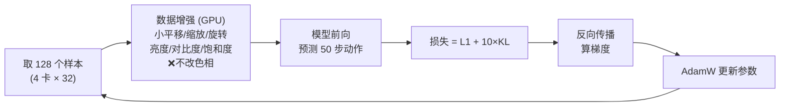
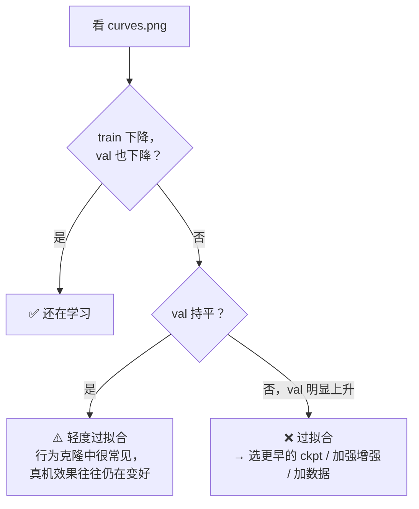

# 03 训练：怎么训、怎么看是否过拟合

> 本页描述旧方案 act_v2（自写 ACT，已交付 `act_v2_*.pt`）。当前主线见 [07_act_ref.md](07_act_ref.md)。

## 训练循环（每一步发生什么）



## 超参数

| 项         | 值                            | 小白解释                               |
| ---------- | ----------------------------- | -------------------------------------- |
| GPU        | 4 × H20，DDP                  | 4 张卡各算一部分样本，梯度合并         |
| batch      | 32 / 卡 = 128                 | 一次看多少样本                         |
| 步数       | 30,000 ≈ 100 轮(epoch)        | 1 轮 = 所有训练样本看一遍（304 步）    |
| 学习率     | 1e-4（ResNet 2e-5）           | 每步改多大；预训练的视觉部分改得更小心 |
| 学习率曲线 | 1000 步预热 → 余弦下降到 5%   | 开始慢慢加速，结尾慢慢收敛             |
| 精度       | bf16 混合精度                 | 更快、省显存                           |
| 速度       | ≈ 950 样本/秒，全程约 70 分钟 |                                        |

## 记录了什么（`runs/<名字>/`）

| 文件            | 内容                                                | 怎么看                      |
| --------------- | --------------------------------------------------- | --------------------------- |
| `metrics.jsonl` | 每 50 步训练损失；每 1000 步验证                    | 每行一个 JSON               |
| `curves.png`    | 自动刷新的曲线图                                    | 直接打开                    |
| `tb/`           | TensorBoard                                         | `tensorboard --logdir runs` |
| `config.json`   | 全部超参数、验证集名单                              | 复现用                      |
| `ckpt/`         | `step_*.pt`（每 5000 步）、`last.pt`、`best_val.pt` | 模型文件，自带归一化统计量  |

## 指标含义

| 指标                       | 意思                                                    | 好的趋势                     |
| -------------------------- | ------------------------------------------------------- | ---------------------------- |
| `train l1`                 | 训练集误差（归一化单位）                                | 下降                         |
| `kl`                       | 风格变量的约束                                          | 很快变得很小，正常           |
| `val l1`                   | **没见过的 8 条示范**上，用 z=0（和机器人上一样）的误差 | 下降或持平                   |
| `first_step_right_arm_rad` | 预测的「下一步」右臂角度误差（弧度）                    | **最贴近真实执行**，越小越好 |
| `right_arm_rad`            | 整个 1.67 秒未来的平均误差                              | 未来越远越不确定，所以偏大   |

## 如何判断过拟合



> 行为克隆的经验：验证损失 ≠ 真机成功率。数据只有 73 条时 train/val 之间有差距是正常的，**最终要靠真机测试**来比较 `step_15000` / `last` 等不同 ckpt。

## act_v1 结果

见 [05_report.md](05_report.md)。

## 常用命令

```bash
bash scripts/setup_venv.sh            # 建 .venv（服务器：torch 2.7.1+cu126；无 GPU 机器加参数 cpu）
.venv/bin/torchrun --nproc_per_node 4 -m yam_train.train --data DATA --out runs/act_v2 --steps 30000 --action-mode delta
tail -f runs/act_v2/metrics.jsonl     # 看进度；曲线 runs/act_v2/curves.png
```
