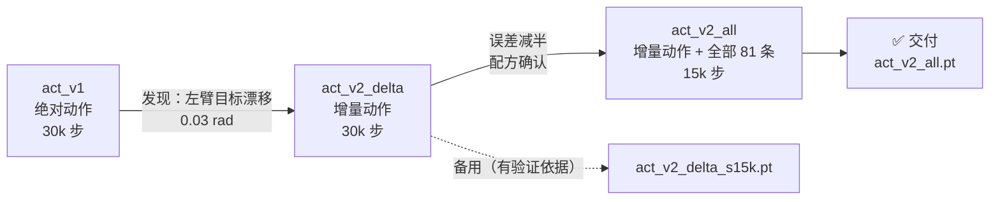
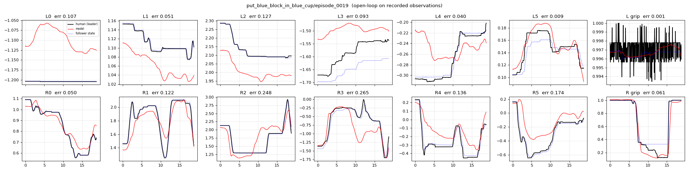
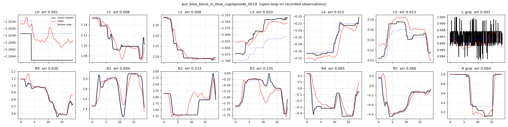
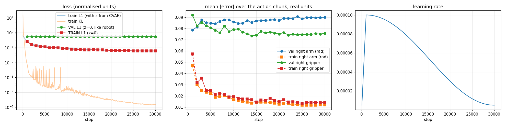

# 05 训练报告与交付模型

> 本页描述旧方案 act_v2（自写 ACT，已交付 `act_v2_*.pt`）。当前主线见 [07_act_ref.md](07_act_ref.md)。

## 实验时间线

## 验证集对比（8 条没参与训练的示范，开环）

| 模型        | 下一步误差 右臂 (rad) | 下一步误差 左臂 (rad) | 右夹爪误差 (0–1) | 结论            |
| ----------- | --------------------- | --------------------- | ---------------- | --------------- |
| v1 @5k      | 0.042                 | 0.028                 | 0.078            |                 |
| v1 @30k     | 0.047                 | 0.035                 | 0.076            | 轻度过拟合      |
| v2 @5k      | 0.020                 | 0.007                 | 0.073            |                 |
| **v2 @15k** | **0.021**             | **0.007**             | **0.066**        | ✅ 最好         |
| v2 @30k     | 0.021                 | 0.007                 | 0.067            | 和 15k 几乎一样 |

> 0.02 rad ≈ 1.2°。「下一步误差」= 给定真实画面，预测的下一步关节目标和人的差距。

### 预测 vs 人（蓝块任务 episode_0019，验证集）

v1（绝对动作）：左臂（上排）红线明显偏离黑线

v2（增量动作）：左臂贴合，右臂跟随更紧

> 黑 = 人（主臂）、红 = 模型、蓝虚线 = 从臂实际。中段偏差主要在「什么时候开始动」上：同样的画面，人有时停顿久一点，开环评估会算作误差。

## 训练曲线（v2）

| 观察                                                       | 解释                                                             | 影响                                     |
| ---------------------------------------------------------- | ---------------------------------------------------------------- | ---------------------------------------- |
| train 误差持续下降到 0.012，val 停在 ~0.085（整段 1.67 s） | 73 条示范 → 模型能「背下」训练集；对新示范的远期预测本身就不确定 | 正常现象；所以选 15k，而且最终靠真机测试 |
| val 没有明显上升                                           | 没有严重过拟合                                                   | 15k / 30k 差别很小                       |
| KL → 1e-5                                                  | 风格变量 z 基本没用上（示范风格很一致）                          | 无害：推理时本来就用 z=0                 |

## 交付

| 文件                   | 用途                                           |
| ---------------------- | ---------------------------------------------- |
| `act_v2_all.pt`        | **默认使用**：v2 配方，用全部 81 条训练 15k 步 |
| `act_v2_delta_s15k.pt` | 备用：有独立验证集数据支撑的版本               |

## 训练配方（复现）

| 模型                   | `torchrun --nproc_per_node 4 -m yam_train.train --data DATA` 之后的参数     | 导出                                                                                                 |
| ---------------------- | --------------------------------------------------------------------------- | ---------------------------------------------------------------------------------------------------- |
| `act_v2_all.pt`        | `--out runs/act_v2_all --steps 15000 --action-mode delta --train-split all` | `python -m yam_train.tools.export runs/act_v2_all/ckpt/last.pt models/act_v2_all.pt`                 |
| `act_v2_delta_s15k.pt` | `--out runs/act_v2_delta --steps 30000 --action-mode delta`                 | `python -m yam_train.tools.export runs/act_v2_delta/ckpt/step_015000.pt models/act_v2_delta_s15k.pt` |
