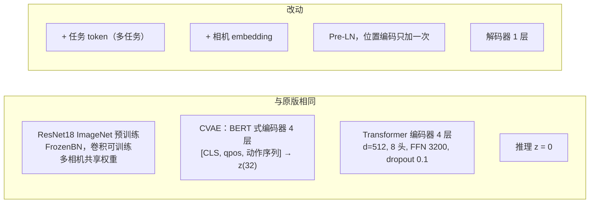

# 06 与 ACT 原论文 / 原代码对比

对照对象：论文 `../policy/act.pdf`（Zhao et al. 2023，ALOHA）+ 官方代码 `../policy/act`（`imitate_episodes.py`、`detr/models/*`、`utils.py`）。

结论：**同一个算法，代码是独立重写，不是复制**。网络的「骨架」与原版实际生效的部分一致；改动主要是工程修正和针对本机器人的适配。没有发现会导致训练出错的问题，有几处值得以后实验的点（见最后）。

## 机器人对比

| 项     | ALOHA（论文）                    | 本项目 YAM                          | 影响                                        |
| ------ | -------------------------------- | ----------------------------------- | ------------------------------------------- |
| 结构   | 双臂主从遥操作，6 关节 + 夹爪 ×2 | 同                                  | 状态/动作同为 14 维                         |
| 观测   | 关节 = 从臂；动作 = 主臂关节     | 同                                  | 数据契约一致                                |
| 相机   | **4 个**：顶部、正面、2 个腕部   | **2 个腕部**（D405）                | 没有全局视角（见风险 1）                    |
| 频率   | 50 Hz                            | 30 Hz（相机帧率）                   | chunk 50 ≈ 1.67 s，原版 100 ≈ 2 s，时长相当 |
| 示范数 | 每任务 50 条                     | 31 + 50 = 81 条（2 个任务一个模型） |                                             |

## 网络结构

| 项                    | 原代码                                                                                            | 本项目                         | 评价                                         |
| --------------------- | ------------------------------------------------------------------------------------------------- | ------------------------------ | -------------------------------------------- |
| 解码器层数            | 配 7 层，但 `return_intermediate_dec=True` 后取 `[0]` → **只有第 1 层输出被用到**                 | 1 层                           | ✅ 与原版**实际**行为一致，省掉 6 层无用计算 |
| 多相机区分            | 每个相机各算 2D 正弦位置编码再拼接 → **两个相机的位置编码完全相同**，网络分不清哪张图来自哪个相机 | 额外加可学习的相机 embedding   | ✅ 修正                                      |
| 多任务                | 一个任务一个模型                                                                                  | 任务 id → embedding token      | ✅ 必需（两任务同一模型）                    |
| LayerNorm 位置        | Post-LN（DETR 默认）                                                                              | Pre-LN + 最后加 LayerNorm      | ⚪ 更稳定的常见写法，结果影响小              |
| 位置编码              | DETR 式：每一层注意力的 q/k 都加                                                                  | 输入时加一次                   | ⚪ 简化写法；残差会把它带到后面的层          |
| `is_pad_head`         | 有，但不参与损失，推理也不用                                                                      | 删掉                           | ✅ 原版就是死代码                            |
| CVAE 输入里的 padding | 末尾补 0，并用 mask 屏蔽                                                                          | 补「最后一帧动作」，**不屏蔽** | ⚠️ 小差异，见风险 3                          |
| 输入分辨率            | 480×640 → 每相机 15×20 = 300 个 token                                                             | 240×320 → 8×10 = 80 个 token   | ⚠️ 见风险 2                                  |
| 参数量                | ≈ 84M（同结构配 7 层解码器估算，其中 6 层不起作用）                                               | 51.6M                          |                                              |

## 损失与数据

| 项            | 原代码                                                             | 本项目                                                    | 评价                                                                                      |
| ------------- | ------------------------------------------------------------------ | --------------------------------------------------------- | ----------------------------------------------------------------------------------------- |
| 损失          | L1 + β·KL，β=10                                                    | 同                                                        | ✅                                                                                        |
| L1 的平均方式 | padding 位置置 0 后**连它一起平均** → episode 末尾的样本损失被稀释 | 只在有效位置平均                                          | ✅ 修正                                                                                   |
| 采样          | 每个 epoch 每条 episode 随机抽 1 个时刻                            | 每个时刻都是一个样本                                      | ⚪ 期望上相同，只是「epoch」含义不同                                                      |
| 动作对齐      | 真机数据用 `action[t-1:]`（手动对齐）                              | 用 `action[t:]`                                           | ✅ 已核对：从臂比主臂晚约 3 帧（100 ms），所以 `主臂(t)` 就是「现在该发的命令」，方向正确 |
| 动作表示      | 绝对关节角                                                         | **增量**：`主臂(t+k) − 从臂(t)`（交付模型）               | ✅ 实验证明误差减半（05_report）                                                          |
| 归一化统计    | 用**全部** episode（验证集泄漏）                                   | 只用训练集                                                | ✅ 修正                                                                                   |
| 数据增强      | 无                                                                 | 平移/缩放/旋转 + 亮度/对比度/饱和度（不改色相）+ 关节噪声 | ✅ 数据少时有用；不改色相是为了区分蓝块                                                   |

## 训练过程

| 项             | 原论文                                               | 本项目                       | 评价                                          |
| -------------- | ---------------------------------------------------- | ---------------------------- | --------------------------------------------- |
| 优化器         | AdamW，wd 1e-4                                       | 同                           | ✅                                            |
| batch / 学习率 | 8 / 1e-5（backbone 1e-5）                            | 128 / 1e-4（backbone 2e-5）  | ✅ batch 大 16 倍，学习率大 10 倍，基本按比例 |
| 学习率曲线     | 恒定                                                 | 预热 1000 步 + 余弦降到 5%   | ⚪                                            |
| 梯度裁剪       | 参数里有，但没调用                                   | 10                           | ⚪                                            |
| 精度           | fp32                                                 | bf16 混合精度                | ⚪ 更快                                       |
| 训练量         | 2000–5000 epoch × 每条 1 样本 ≈ 每帧被看到约 5–10 次 | 15k 步 × 128 ≈ 每帧约 50 次  | ⚠️ 多很多，见风险 4                           |
| 选最佳 ckpt    | 验证损失（用 CVAE 编码器的 z，**和推理不一样**）     | z=0 的验证 L1 + 真实单位误差 | ✅ 更接近真机                                 |
| 多卡           | 单卡                                                 | 4 卡 DDP                     | ⚪                                            |

## 推理（不在本仓库，只列差异）

| 原论文                      | yam_infer                                                           |
| --------------------------- | ------------------------------------------------------------------- |
| 每步都预测，时间集成 k=0.01 | 每次预测执行约 1 秒再重新预测（真机上时间集成会停住，见 05_report） |

## 需要关注的点（不是 bug，按重要性排序）

| #   | 点                         | 依据                                                           | 建议实验                                                                       |
| --- | -------------------------- | -------------------------------------------------------------- | ------------------------------------------------------------------------------ |
| 1   | 只有腕部相机，没有全局视角 | 原版用了 4 个相机；挑蓝块需要看全场                            | 硬件层面：考虑加一个固定的顶部相机                                             |
| 2   | 分辨率减半                 | 每相机只有 80 个视觉 token；小物体/精确抓取会吃亏              | 用 `convert --height 480 --width 640` 重新转数据，训一版对比（显存/速度约 ×3） |
| 3   | CVAE 编码器不屏蔽 padding  | 只影响 episode 最后 1.7 秒的样本；而且 KL→1e-5，z 基本没被使用 | 影响很小，暂不改；要改时同步 yam_infer 不需要（推理不用 CVAE 编码器）          |
| 4   | 训练量远多于原版           | 验证曲线 5k 之后基本持平，没有明显上升                         | 真机比较 5k / 15k 两个 ckpt                                                    |
| 5   | 验证集只有 8 条            | 指标噪声大                                                     | 结论以真机为准                                                                 |
| 6   | 左臂几乎不动               | 抽样两条 episode 中左臂关节变化 < 0.01 rad                     | 不影响训练；左臂误差指标意义不大                                               |
