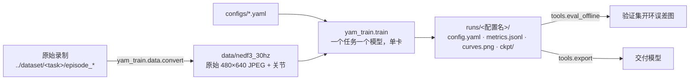
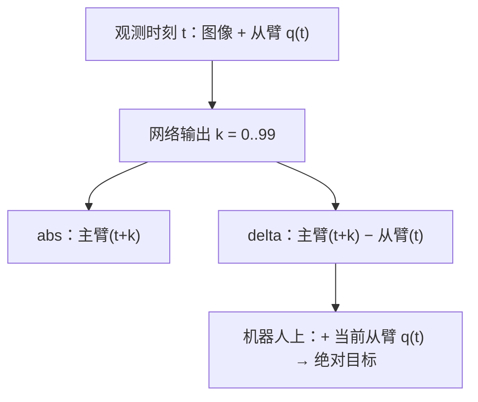

# 07 act_ref：按 ACT 源码训练（当前主线）

01–05 描述的是旧的 act_v2 方案（自己重写的 ACT）。从这里开始按 `tonyzhaozh/act` 源码训练。和源码只有两处不同：多了可选的动作表示 `delta`；`action_shift` 改为 0（见下文）。

## 流程



## 和源码的对应关系

| 本仓库 | 源码 | 改动 |
|---|---|---|
| `yam_train/detr/` | `detr/models/*`、`detr/util/misc.py` | 只改了 import 路径、删掉 IPython 调试行（见 VENDORED.md） |
| `yam_train/policy.py` | `policy.py::ACTPolicy` + `detr/main.py` 里建优化器的函数 | 参数从配置传入，不再读命令行 |
| `yam_train/data/dataset.py` | `utils.py`（EpisodicDataset / get_norm_stats / load_data） | 加了 `delta`；按 chunk 长度补齐（截断后与源码相同） |
| `yam_train/train.py` | `imitate_episodes.py::main / train_bc` | 读 YAML；另外记录 z=0 的误差（不影响训练） |
| `tools/eval_offline.py` | `eval_bc` 里的时间集成 | 在录制数据上开环跑，不连真机 |

已用代码验证（同一份权重、同一组输入）：参数名、优化器分组、训练损失、推理输出都与源码**完全相同**；数据的归一化统计、80/20 划分、`t-1` 对齐（`action_shift: 1` 时）、padding 也与源码逐元素相同。

## 配置（`configs/`）

| 文件 | 内容 |
|---|---|
| `act_ref.yaml` | 源码的全部默认值（数据 / 网络 / 训练），其他配置都继承它 |
| `block_bowl_abs.yaml` / `blue_cup_abs.yaml` | 积木放碗 / 蓝块放蓝杯，动作 = 主臂关节（源码做法） |
| `block_bowl_delta.yaml` / `blue_cup_delta.yaml` | 同上，动作 = 主臂关节 − chunk 起点的从臂关节 |

## 数据（`../dataset`）

| 任务 | 配置前缀 | 条数 | 每条时长 | 训练 / 验证 | 内容 |
|---|---|---|---|---|---|
| `put_block_in_bowl` | `block_bowl_` | 49（episode_0024 失败已删） | 11–34 s，平均 16 s | 39 / 10 | 积木在左、碗在右，位置关系固定，把积木放进碗 |
| `put_blue_block_in_blue_cup` | `blue_cup_` | 50 | 14–25 s，平均 18 s | 40 / 10 | 1–6 个不同颜色积木，只有一个蓝积木和一个蓝杯，把蓝积木放进蓝杯 |

两个任务都是双臂一起动（左臂动作幅度 0.8 / 1.4 rad）。录制里的 `head` 相机是黑屏占位，不使用。转换后共 4.1 GB。

| 关键项 | 值 | 来源 |
|---|---|---|
| `chunk_size` | 100 | README / 论文表 III |
| `lr` / `lr_backbone` | 1e-5 / 1e-5 | 同上 |
| `batch_size` | 8 | 同上 |
| 层数 | 编码器 4，解码器 7（实际只用第 1 层的输出，源码就是这样） | `imitate_episodes.py` |
| `kl_weight` | 10 | 同上 |
| `num_epochs` | 5000 | README：真机数据至少 5000 |
| 图像 | 2 个腕部相机，原始 480×640 | 源码不缩放 |
| 每个 epoch | 先跑验证 → 每条训练 episode 随机抽 1 个时刻 | `utils.py` |
| `action_shift` | **0**（源码为 1） | 见下节 |

单次运行时临时覆盖：`--set train.num_epochs=100 --set data.action_mode=delta`。

## action_shift：为什么改成 0

chunk 第 0 步 = 主臂(t − `action_shift`)。源码在真机数据上用 1（注释写的是 `hack, to make timesteps more aligned`），是在修 ALOHA 录制流程的对齐问题；这套数据按时间戳对齐，所以用 0。

| 实测（两个任务） | 结果 |
|---|---|
| 腕部图像 vs 从臂关节 | 同一帧（右腕中位数 0 帧） |
| 从臂比主臂晚 | 4 帧 ≈ 133 ms |
| 1 → 0 目标的变化 | 0.002–0.003 rad，约为主从差距 0.022 rad 的 12%、chunk 内移动 0.146 rad 的 2% |

→ 主臂(t) 就是看到画面那一刻人发出的命令。差别很小；要复现源码，加 `--set data.action_shift=1`。

## 动作表示



| 选择 | 结论 | 理由 |
|---|---|---|
| 用主臂还是从臂当动作 | **主臂** | ① 主臂是人发出的命令，从臂要晚约 100 ms 才到；② 夹住物体时人把主臂夹爪合到 0.15，从臂被物体挡住只到 0.20。如果学从臂，模型永远不会「用力夹」 |
| abs 还是 delta | 两种都训，真机对比 | delta 让网络只学「接下来怎么动」，和机器人当前在哪无关，旧方案中误差减半；abs 是源码做法。都是同一个 chunk 起点，执行时不会累计误差 |

## 命令

```bash
bash scripts/setup_venv.sh                                    # 服务器（cu126）；本机加 cpu
python -m yam_train.data.convert --raw ../dataset --out data/nedf3_30hz --workers 16
CUDA_VISIBLE_DEVICES=0 python -m yam_train.train --config configs/block_bowl_abs.yaml
CUDA_VISIBLE_DEVICES=1 python -m yam_train.train --config configs/block_bowl_delta.yaml
CUDA_VISIBLE_DEVICES=2 python -m yam_train.train --config configs/blue_cup_abs.yaml
CUDA_VISIBLE_DEVICES=3 python -m yam_train.train --config configs/blue_cup_delta.yaml
python -m yam_train.tools.eval_offline --ckpt runs/block_bowl_abs/ckpt/best.pt --data data/nedf3_30hz --out runs/block_bowl_abs/eval
python -m yam_train.tools.export runs/block_bowl_abs/ckpt/best.pt models/block_bowl_abs.pt
```

## 推理端（yam_infer）需要跟着改

| 项 | 旧 act_v2 | act_ref |
|---|---|---|
| 模型代码 | 自写 ACT | `yam_train/detr` + `policy.py`（checkpoint 里 `format = yam_train/act_ref-v1`） |
| 输入图像 | 240×320 | 480×640 原图（训练用的是录制时的 JPEG） |
| 模型个数 | 1 个多任务 | 每个任务一个 |
| chunk | 50 | 100 |
| 执行方式 | 执行 1 秒再重新预测 | 源码：每步都预测，时间集成 k=0.01（最旧的预测权重最大） |
| 动作 | delta | 看 checkpoint 的 `action_mode`；`delta` 要加上当前从臂状态 |
