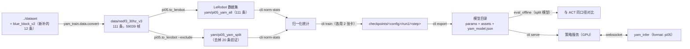
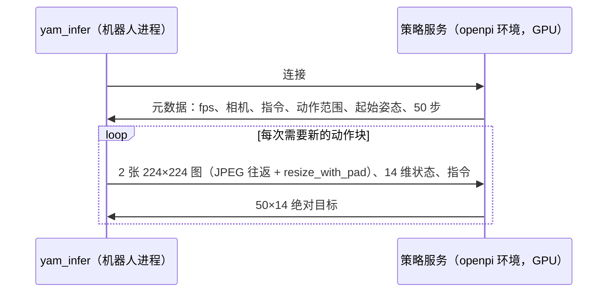
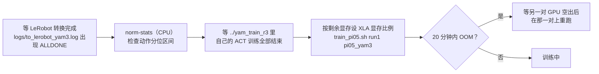

# 08 pi0.5：用 openpi 微调（`pi05` 分支）

pi0.5（π₀.₅）是 Physical Intelligence 开源的 VLA（vision-language-action，视觉-语言-动作）模型。本分支用它的官方代码 [openpi](https://github.com/Physical-Intelligence/openpi)（固定在 commit `215abfb`）在我们的两个任务上做**全参数微调**。和 ACT（07）的主要区别：

| | ACT（act_ref） | pi0.5 |
|---|---|---|
| 规模 | 84M 参数，从零训练（只有 ResNet18 用 ImageNet 预训练） | 3.3B 参数，从 `pi05_base` 继续训练。`pi05_base` 已在 1 万多小时的多种机器人数据上学过 |
| 看图 | ResNet18 | SigLIP 视觉编码器 + Gemma 2B 语言模型（PaliGemma） |
| 任务 | 一个任务一个模型 | **一个模型两个任务**，用一句英文指令区分 |
| 动作生成 | 一次前向直接输出 | flow matching：从随机噪声出发，迭代 10 步去噪得到动作块 |
| 动作块 | 100 步（3.3 s） | 50 步（1.67 s） |
| 图像 | 480×640 原图 | 等比缩放到 224×168，上下补黑边成 224×224 |
| 框架 | PyTorch，yam_train 自己的 `.venv` | JAX，openpi 自己的 uv 环境（`../openpi/.venv`） |
| 推理 | yam_infer 进程内直接跑 | 单独的**策略服务**进程，yam_infer 通过 websocket 发观测、收动作 |

为什么值得试：ACT 在新的积木摆放位置上对不准（见真机分析），根本原因是示范数据少、模型从零学看图。pi0.5 的视觉和动作部分都经过大规模预训练，通常在小数据集上泛化更好。不过它也可能不适用于我们的机器人（openpi 自己的 README 也这么说），所以要先离线评估，再上真机对比。

## 流程



## 数据

| 任务 | 指令（prompt） | 示范条数 | split 运行中留作验证的条数 |
|---|---|---|---|
| `put_block_in_bowl` | `put the block in the bowl` | 49 | 10 |
| `put_blue_block_in_blue_cup` | `put the blue block in the blue cup` | 50 + 12（`blue_block_v2`） | 10 |

- **新数据的存放位置**：`blue_block_v2` 在 `put_blue_block_in_blue_cup/` 下面多了一层目录。`yam_train.data.convert` 现在也会读 `<task>/<子目录>/episode_*`，任务名取最上层目录，episode 名保留子目录（例如 `put_blue_block_in_blue_cup/blue_block_v2/episode_0000`）。
- **跳过未完成的录制**：没有 `data/mcap_index.json` 的 episode 会被跳过。`blue_block_v2/episode_0012` 只有 5 MB，文件被截断、读不出来，用户已把它删除，所以实际用到 12 条。
- **与旧数据一致**：新转换的 `data/nedf3_30hz_v3` 中，原来 99 条的关节数据和 v1 的 `data/nedf3_30hz` 逐元素相同（已验证）。
- **验证集**：留出的 20 条（`configs/pi05/val_episodes.json`）就是 ACT split 运行留出的那 20 条，所以离线指标可以直接和 ACT 比。

### 相机的放法

pi0.5 有 3 个图像位置：`base_0_rgb`（第三人称全景）、`left_wrist_0_rgb`、`right_wrist_0_rgb`。

| 我们的相机 | 放到哪个位置 | 理由 |
|---|---|---|
| 左腕 D405 | `base_0_rgb` | 左臂在示范里几乎不动，左腕相机实际上是一个俯视整张桌子的固定视角 |
| 右腕 D405 | `right_wrist_0_rgb` | 干活的手 |
| — | `left_wrist_0_rgb` | 填黑图，mask = False，模型不看这部分 |

### 动作表示

| 维度 | 表示 | 理由 |
|---|---|---|
| 右臂 6 个关节 | delta：主臂目标 − 当前从臂状态 | openpi 对关节空间机器人的惯例（aloha）；ACT 的分析也表明 delta 抓取对得更准 |
| 左臂 6 个关节 | 绝对值 | 左臂不动，delta 几乎全是 0。1%–99% 分位数区间只有 ±0.001 rad，按分位数归一化后，偶尔的真实动作会被放大到 100–300 倍（正常应在 ±1 附近）。改用绝对值后在 ±1.5 以内 |
| 两个夹爪 | 绝对值 | openpi 惯例 |

服务端会把输出还原成绝对目标，yam_infer 收到的就是绝对关节角。

**归一化**是什么：把每个维度线性缩放，使 1% 分位数对应 −1、99% 分位数对应 +1。pi0.5 用分位数而不是均值和标准差。状态还会再被离散成 256 档，作为文字 token 放进 prompt。统计量由 `cli norm-stats` 从训练数据算出，随 checkpoint 一起保存。

## 训练

| 项 | 值 | 来源 / 理由 |
|---|---|---|
| 起点 | `gs://openpi-assets/checkpoints/pi05_base` | openpi 官方，用于微调 |
| 方式 | 全参数微调，bf16 | openpi 默认 |
| batch | 32 | openpi 默认（`pi0_aloha_pen_uncap` 等） |
| 步数 | 15000 ≈ 48 万个样本 ≈ 把 5.9 万帧过 8 遍 | openpi 示例为 2–3 万步。在 2 张 H20 上，batch 64 每步 4.7 s，所以选 batch 32 × 15k 步，约 10 小时 |
| 学习率 | 余弦衰减：1000 步 warmup 到 2.5e-5，之后降到 2.5e-6 | openpi 默认 |
| 优化器 | AdamW，梯度裁剪 1.0 | openpi 默认 |
| EMA | 0.99（保存的是 EMA 权重） | openpi 默认 |
| 硬件 | 2 张 H20，FSDP（把模型切开分到 2 张卡上） | 显存约 88 GB/卡 |
| checkpoint | 每 1000 步存一次，5000 的倍数永久保留。每个 43 GB，其中 params 12 GB、优化器状态 31 GB | — |

两个运行同时进行（`scripts/train_pi05.sh`）：

| 运行 | GPU | 数据 | 用途 |
|---|---|---|---|
| `pi05_yam_split/run1` | 0,1 | 91 条（去掉验证的 20 条） | 离线评估，和 ACT 比，选步数 |
| `pi05_yam/run1` | 2,3 | 全部 111 条 | 上真机的模型（用同一步数） |

**flow matching 的损失**：训练时把真实动作块和随机噪声按比例混合，让网络预测"从噪声指向真实动作的方向"。损失就是这个方向的均方误差。数值小不代表动作准，因为它衡量的是去噪中的某一步。所以选模型要看 `eval_offline`。

## 离线评估（`yam_train.pi05.eval_offline`）

在验证集的录制数据上开环预测，和 ACT 的抓取测试口径相同：

- **抓取测试**：取示范中第一次合夹爪前 0.5 / 1 / 2 s 的画面，让模型预测动作块，读出它计划在合夹爪那一刻到达的右臂姿态，和人的实际姿态比较。误差 < 0.04 rad（约 1.5 cm）算"对准"。
  - ACT v1 delta 在 1 s 时的结果：积木 0.029 rad（8/10 对准），蓝杯 0.028 rad（8/10 对准）。
- **动作块误差**：每 15 帧预测一次，看前 10 / 30 步与主臂的平均误差。

## 命令（服务器）

```bash
cd ~/output/fufu/yam_train_pi05
bash scripts/setup_openpi.sh                       # openpi + uv 环境 + pi05_base（只需一次）
source scripts/pi05_env.sh
PYTHONPATH=. ../yam_train/.venv/bin/python -m yam_train.data.convert --raw ../dataset --out data/nedf3_30hz_v3
$PI05_PY -m yam_train.pi05.to_lerobot --data data/nedf3_30hz_v3 --repo-id yam/pi05_yam_all
$PI05_PY -m yam_train.pi05.to_lerobot --data data/nedf3_30hz_v3 --repo-id yam/pi05_yam_split --exclude configs/pi05/val_episodes.json
$PI05_PY -m yam_train.pi05.cli norm-stats --config pi05_yam          # 另一个配置 pi05_yam_split 同样
bash scripts/train_pi05.sh run1                    # 两个运行，日志 logs/train_<config>_run1.log
$PI05_PY -m yam_train.pi05.cli export --ckpt runs_pi05/checkpoints/pi05_yam_split/run1/14999 --out models/pi05_yam_split
$PI05_PY -m yam_train.pi05.eval_offline --model models/pi05_yam_split --data data/nedf3_30hz_v3 --out runs_pi05/eval/split_14999
$PI05_PY -m yam_train.pi05.cli serve --model models/pi05_yam --port 8000
```

## 部署（yam_infer `pi05` 分支）



- **服务可以跑在两个地方**：
  - 机器人电脑（RTX 5090，`--server 127.0.0.1:8000`）。需要在机器人上装 openpi 环境和模型目录（约 12 GB）。JAX 0.5.3 在 Blackwell（RTX 50 系）上可能要换新版 `nvidia-cuda-nvcc-cu12`，需要真机验证。
  - 训练服务器，通过 SSH 隧道转发端口。
- **推荐执行方式**：`run.yaml` 设 `mode: chunk, horizon: 25, blend_s: 0.1`，每 0.83 s 重新规划一次。pi0.5 每次推理约 100 ms，不适合每帧都推理的 ensemble 模式。
- **左臂**：`freeze_left: true`。

## 结果（run1，2026-11-01）

两个运行都已训练完成（15000 步，各约 10.3 小时）。

在 20 条验证示范上开环评估 split 运行。ACT 一行用的是同一批验证示范、同一套计算方法（只看右臂，单位 rad）：

| 模型 | 任务 | 抓取误差 0.5 s | 1 s | 2 s | 对准 @1 s | 动作块误差 10 步 | 30 步 |
|---|---|---|---|---|---|---|---|
| ACT v1 delta | 积木放碗 | 0.018 | 0.029 | 0.089 | 8/10 | 0.036 | 0.067 |
| pi05 1000 步 | 积木放碗 | 0.016 | 0.026 | 0.055 | 9/10 | 0.030 | 0.059 |
| pi05 5000 步 | 积木放碗 | 0.015 | 0.021 | 0.033 | 10/10 | 0.029 | 0.058 |
| pi05 10000 步 | 积木放碗 | 0.017 | 0.020 | 0.027 | 9/10 | 0.032 | 0.058 |
| **pi05 14999 步** | 积木放碗 | 0.017 | **0.019** | **0.029** | **10/10** | 0.033 | 0.058 |
| ACT v1 delta | 蓝块放蓝杯 | 0.021 | 0.028 | 0.059 | 8/10 | 0.042 | 0.076 |
| **pi05 14999 步** | 蓝块放蓝杯 | 0.019 | **0.026** | **0.049** | **9/10** | 0.033 | 0.060 |

- **结论**：提前 1 s 时略好于 ACT；提前 2 s 时明显更好（积木放碗 0.089 → 0.029）。也就是说，pi0.5 在离抓取还远的时候就已经知道该往哪里去，而这正是 ACT 在真机上失败的环节。
- **选哪一步**：10000 步之后基本不再变化，所以交付全部数据训练的 14999 步：`models/pi05_yam`（12 GB）。
- **动作块误差的口径**：1000 / 5000 步是每 60 帧评估一次，10000 / 14999 步是每 15 帧评估一次，所以这一列只适合粗略比较。
- **推理速度（H20）**：第一次推理需要编译，约 19 s，`serve` 在接受连接前会先做两次预热推理；之后每次约 95–105 ms。
- **端到端链路**：从用户电脑经 SSH 隧道连到服务器，用 `yam_infer --dry-run` 回放录制数据，每个动作块往返约 170 ms。
- **开环评估的局限**：它只能说明"看到示范画面时，模型预测得对不对"。闭环中误差会累积，而且这次留出的验证集里没有偏右的积木摆放位置，所以最终仍要看真机结果。

## pi05_yam3：蓝块放蓝杯 + 两个双臂任务（训练中，结果待补）

数据换成 r3 那一批（和 07 的 r3 ACT 训练同一份）。与上面的 `pi05_yam` 的区别：

| 项 | `pi05_yam` | `pi05_yam3` |
|---|---|---|
| 任务 / 指令 | 积木放碗、蓝块放蓝杯 | `put the blue block in the blue cup`（100 条）、`fold the towel`（51 条）、`hold the cylinder with both hands and pull the cap off`（50 条） |
| 转换数据 | `data/nedf3_30hz_v3` | `data/nedf3_30hz_r3`（约 11.7 万帧，是 `pi05_yam` 的两倍） |
| LeRobot 数据集 | `yam/pi05_yam_{all,split}` | `yam/pi05_yam3_{all,split}` |
| delta 的维度 | 只有右臂 6 个关节（`DELTA_MASK`） | **两臂** 12 个关节（`DELTA_MASK_BOTH`，openpi aloha 惯例）；夹爪仍是绝对值 |
| 为什么左臂也能 delta | — | 双臂任务里左臂真的在动，左臂 delta 的 1%–99% 分位区间不再接近 0，不会出现上面说的放大问题。`pi05_after_act.sh` 在训练前检查：任一动作维度区间 < 0.005 就停止 |
| 验证集 | `configs/pi05/val_episodes.json`（2 × 10） | `configs/pi05/val_episodes_yam3.json`（蓝杯 20、毛巾 11、圆筒 10）= r3 ACT split 运行的验证集 |
| 步数 | 15000 | 20000 |
| 新增评估指标 | — | `both arms 30`：30 步内两臂 12 个关节的平均误差（双臂任务看这个） |
| 推理端 | `freeze_left: true` | 毛巾、圆筒**不能**冻结左臂 |

配置定义在 `yam_train/pi05/config.py` 的 `CONFIGS`，任务指令在 `yam_policy.py` 的 `PROMPTS`。

### 无人值守启动

服务器上 r3 的 ACT 训练占着 GPU，所以用 `scripts/pi05_after_act.sh` 排队：



```bash
cd ~/output/fufu/yam_train_pi05 && source scripts/pi05_env.sh
T="put_blue_block_in_blue_cup fold_towel unroll_cylinder"
( $PI05_PY -m yam_train.pi05.to_lerobot --data data/nedf3_30hz_r3 --repo-id yam/pi05_yam3_all --tasks $T &&
  $PI05_PY -m yam_train.pi05.to_lerobot --data data/nedf3_30hz_r3 --repo-id yam/pi05_yam3_split --tasks $T \
    --exclude configs/pi05/val_episodes_yam3.json && echo ALLDONE ) > logs/to_lerobot_yam3.log 2>&1 &
setsid nohup bash scripts/pi05_after_act.sh pi05_yam3 run1 > logs/pi05_after_act.log 2>&1 &
grep 'Progress on' logs/train_*_run1.log | tail                                                   # 进度
```

`train_pi05.sh` 的参数：`[EXP] [CONFIG]`；环境变量 `GPUS_SPLIT/GPUS_ALL` 换 GPU，`MEM_SPLIT/MEM_ALL` 设显存比例（默认 0.9），`ONLY=split|all` 只起一个。
