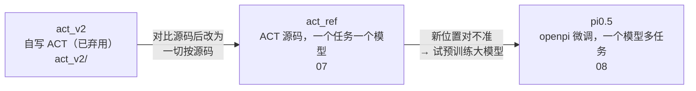

# yam_train 文档索引

## 当前文档

| 文档 | 内容 |
|---|---|
| [07_act_ref.md](07_act_ref.md) | **ACT 主线**：与源码的对应、配置、四个任务的数据、action_shift、abs / delta、选模型、命令、推理端改动 |
| [08_pi05.md](08_pi05.md) | **pi0.5**：openpi 微调、相机与动作表示、训练参数、离线评估、部署、run1 结果、`pi05_yam3`（双臂任务） |
| [VENDORED.md](VENDORED.md) | 从 `tonyzhaozh/act` 拷贝的代码及本地改动 |
| [../SEVERS.md](../SEVERS.md) | 三台机器（用户电脑 / 机器人 / 训练服务器） |

## 旧方案 act_v2（只作历史参考，已交付 `act_v2_*.pt`）

| 文档 | 内容 |
|---|---|
| [act_v2/01_data.md](act_v2/01_data.md) | 录制数据的发现（只有右臂动、主从延迟、相机）、转换流程、14 维向量定义 |
| [act_v2/02_model.md](act_v2/02_model.md) | ACT 入门：动作分块、时间集成、CVAE；绝对 vs 增量动作 |
| [act_v2/03_training.md](act_v2/03_training.md) | 训练循环、指标含义、如何判断过拟合 |
| [act_v2/05_report.md](act_v2/05_report.md) | v1 / v2 结果与交付模型 |
| [act_v2/06_act_comparison.md](act_v2/06_act_comparison.md) | act_v2 与 ACT 论文 / 源码逐项对比（促成 act_ref） |

> 新手建议顺序：act_v2/01 → act_v2/02（概念）→ 07 → 08。14 维向量的定义（act_v2/01）全项目通用。

## 任务一览

| 任务 | 条数 | 用臂 | ACT 配置 | pi0.5 配置 |
|---|---|---|---|---|
| `put_block_in_bowl` | 49 | 右 | `block_bowl_{abs,delta}` | `pi05_yam` |
| `put_blue_block_in_blue_cup` | 100 | 右 | `blue_cup_{abs,delta}` | `pi05_yam`（前 50 + 12 条 v2）、`pi05_yam3` |
| `fold_towel` | 51 | 双 | `fold_towel_{abs,delta}` | `pi05_yam3` |
| `unroll_cylinder` | 50 | 双 | `unroll_cylinder_{abs,delta}` | `pi05_yam3` |
